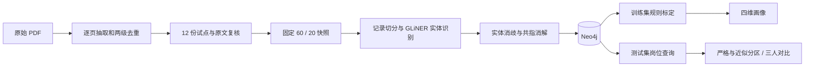
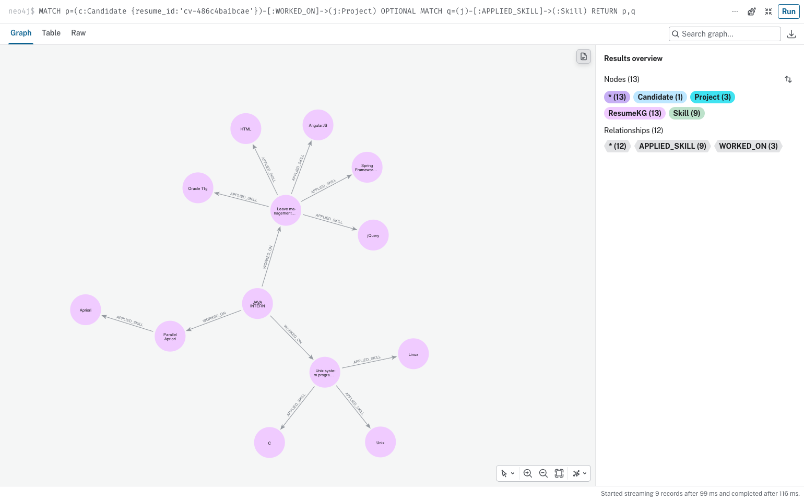

# 简历知识图谱与岗位匹配技术说明

智能信息系统建模　作业 2

丁宇轩 · 524031910745 · 独立完成全流程设计、开发、测试、录屏及文档撰写 · 贡献比例 100%。

本文件汇总完整的样本统计、双边引文、规则阈值与查询。业务操作流程见[项目说明](项目说明.md)。

## 系统架构与复现



本次使用 uv 与 Python 3.11.15，数据库为 Neo4j/5.26.33 Community，实体识别模型为 `urchade/gliner_medium-v2.1`。GLiNER 在每条带页码的记录中标注人、机构、学位、岗位及技能等实体跨度。技能词典补全易漏的短词和带符号语言。窗口输出落盘，改图谱算法时可复用。

从项目根目录执行 `.venv/bin/python scripts/verify_acceptance.py` 可独立核对原始 PDF、实时图库、规则与打包件。各阶段的重建命令见 [README](../README.md)。

## 数据治理与试点

输入来自公开数据集 [Mehyaar/Annotated_NER_PDF_Resumes](https://huggingface.co/datasets/Mehyaar/Annotated_NER_PDF_Resumes)。对归档 PDF 计算 SHA-256，逐页抽取后对 NFKC、空白及大小写规范化文本再计算 SHA-256。文本优先使用 PyMuPDF，提取出错或未返回文字时尝试 pdfplumber。

| 语料处理 | 份数 |
|---|---|
| 归档 PDF | 5035 |
| 重复文件 | 1222 |
| 异文件同文本 | 430 |
| 空文本或质量过滤 | 292 |
| 无法提取 | 1 |
| 教育、任职或技能标题不完整 | 2200 |
| 岗位词或页数筛选 | 748 |
| 符合选样条件 | 142 |

在 142 份符合范围的简历中另行比较连续五词集合，Jaccard 相似度为交集大小除以并集大小。达到 0.70 的版本视为同组，保留英文词数较多的一份，同长按文本哈希确定。按此规则另剔除 1 个改写版本。最初的双哈希快照曾含相近的 .NET 岗位简历，本次在分配 train/test 前过滤该组，再按既定种子从同层候补中补入。原 20 份测试简历、预设岗位需求和 12 份试点成员均保持固定。复查全部 60 × 20 个跨集组合，最高五词 Jaccard 为 0.0072。

两级共排除 1652 份重复。哈希互斥检验覆盖相同字节或相同规范化全文；同一人可能有内容不同的简历版本。软件与数据岗位样本需包含三类标题和至少三种领域词，取四页以内的简历。按文本哈希排序，以 seed=42 洗牌，兼顾有无独立项目标题的版式。测试集先固定，训练集预留品牌歧义上下文的分层入口。样本代表这一岗位与版式范围。

最终保留 172 页。文件哈希跨集交集为 0，文本哈希跨集交集为 0。快照签名为 `686a9264529e17de4672c92d92b8f5e6ef488b4f9c89ee25afbf1f7fd41cc1eb`。

试点覆盖 12 份训练简历和 12 种版式特征组合，产生 144 条记录、407 条关系。已逐份核对 12 份试点。修复匿名占位和客户被误认作雇主、项目内部字段被拆成新项目及持续任职日期漏识别。Oracle 的任职声明和 RDBMS 实操引文分别支持雇主和技术义项；双栏中无法确定归属的日期保留未知。

[试点逐记录核对表](../data/processed/pilot_audit.md) · [逐份抽查记录](../data/processed/pilot_review_notes.md)

## 原文证据与图谱规模

项目、任职、学历三种记录分别保留页内和全文字符偏移。项目中的技术通过 APPLIED_SKILL 连边，任职中的技术使用 USED_SKILL。候选人 HAS_SKILL 的 source 区分 listed、work_verified 与 project_verified。仅技能表中的词只进入列举技能。每条关键关系保留简历编号、页码和最长 240 字符的引文，验收时重新读取 PDF 并检查原文及所属记录。

全量抽取 870 条记录与 5791 个模型实体提及。实时图库的 2233 条关键关系中，2233 条通过逐页引文校验（100.00%）。该比例衡量引文能否在对应页面找到。抽取语义准确性另见逐份试点记录。

| 口径 | 可达节点 | 可达关系 |
|---|---|---|
| train | 799 | 2035 |
| test | 336 | 672 |
| all | 1058 | 2707 |

| 节点类型 | train | test | all |
|---|---|---|---|
| Candidate | 60 | 20 | 80 |
| Company | 20 | 5 | 25 |
| Education | 95 | 31 | 126 |
| JobTitle | 134 | 58 | 181 |
| Project | 21 | 10 | 31 |
| Skill | 174 | 97 | 209 |
| University | 71 | 22 | 89 |
| WorkExperience | 224 | 93 | 317 |

| 关系类型 | train | test | all |
|---|---|---|---|
| APPLIED_SKILL | 48 | 24 | 72 |
| AT_COMPANY | 22 | 5 | 27 |
| AT_UNIVERSITY | 84 | 25 | 109 |
| HAS_EDUCATION | 95 | 31 | 126 |
| HAS_EXPERIENCE | 224 | 93 | 317 |
| HAS_SKILL | 1078 | 321 | 1399 |
| HELD_ROLE | 184 | 72 | 256 |
| USED_SKILL | 279 | 91 | 370 |
| WORKED_ON | 21 | 10 | 31 |

统计从对应 split 的 Candidate 出发，沿领域有向边向外最多两跳，以 DISTINCT 分别计数。跨集可共享技能、学校、公司等实体，全图计其并集。




图例取自主查询候选人 cv-486c4ba1bcae。WORKED_ON 连到三个独立项目，APPLIED_SKILL 连到各项目原文中出现的技能。下面的只读查询可复现截图。

```cypher
MATCH p=(c:Candidate {resume_id:'cv-486c4ba1bcae'})-[:WORKED_ON]->(j:Project)
OPTIONAL MATCH q=(j)-[:APPLIED_SKILL]->(:Skill)
RETURN p, q
```

## 实体消歧、别名归并与文内指代

消歧使用局部词窗、段落位置及同记录实体共现三类信号。词窗与义项上下文原型通过词频–逆文档频率向量的余弦相似度比较。综合分为 0.50 × 词窗相似度 + 0.30 × 段落先验 + 0.20 × 同记录一致性。只有训练原文支持两个真实目标且两条边都存在时，才计为一组。

### Associate

| 原文位置 | 引文 | 真实连边与目标 | 各义项综合分 |
|---|---|---|---|
| cv-771147ab37cf · p.1 | Company Name October 2010 to December 2012 Senior Associate Software developer | HELD_ROLE → JobTitle · Senior Associate | job_rank 0.542 / degree 0.000 |
| cv-af8a8f11c0f9 · p.3 | Stratford University City , State , US Associate of Applied Science : Network Management and Security Stratford University, Woodbridge, VA | HAS_EDUCATION → Education · Associate of Applied Science / Network Management and Security / Stratford University | job_rank 0.211 / degree 0.540 |

### IBM

| 原文位置 | 引文 | 真实连边与目标 | 各义项综合分 |
|---|---|---|---|
| cv-771147ab37cf · p.2 | Implemented services integration using (JMS) and MDB in the form of XML messages over IBM MQ Series. | USED_SKILL → Skill · IBM MQ Series | company 0.024 / product 0.409 |
| cv-cb2be31d7dcd · p.2 | Name and address of employer IBM Global Services | AT_COMPANY → Company · IBM Global Services | company 0.520 / product 0.239 |

### MS

| 原文位置 | 引文 | 真实连边与目标 | 各义项综合分 |
|---|---|---|---|
| cv-dddc8ea0cd55 · p.3 | SQL, MS Office (Excel, Word, Power Point, Access). | HAS_SKILL → Skill · Microsoft Office | degree 0.000 / product 0.550 |
| cv-0a680fbaec1b · p.2 | MS : Computer Science , 1992 University of New Haven ï¼​ City , State , US MS in Computer Science University of New Haven - New Haven, | HAS_EDUCATION → Education · MS / Computer Science / University of New Haven | degree 0.568 / product 0.030 |

### Oracle

| 原文位置 | 引文 | 真实连边与目标 | 各义项综合分 |
|---|---|---|---|
| cv-771147ab37cf · p.1 | Used Oracle RDBMS as user store, implemented Liquibase for identity and authorization. | APPLIED_SKILL → Skill · Oracle RDBMS | company 0.024 / product 0.255 |
| cv-4413e32e23ef · p.1 | having worked for Oracle for a period of 11 years | AT_COMPANY → Company · Oracle | company 0.316 / product 0.030 |

验证双边组 4，另记录 54 条被上下文判为普通词或其他噪声的提及。

受保护的符号参与规范化。实体先做同类型规范名与缩写归并，机构相似写法再结合字符 n-gram 和邻域验证。合并前 1077 个节点，合并后 1058 个，压缩率 1.76%。训练集中检出跨文档别名组 11 组；全量记录内识别 152 处指代。同文档的第一人称指向候选人，机构或项目泛指结合本条记录中的先行实体判定。

| 规范实体 | 异名证据 A | 异名证据 B |
|---|---|---|
| Machine Learning | Machine learning · cv-b43de39e1042 p.1 | ML · cv-5c381f71960d p.1 |
| Artificial Intelligence | Artificial Intelligence · cv-b43de39e1042 p.1 | AI · cv-f256998a148b p.1 |
| Microsoft SQL Server | MS SQL Server · cv-6ca6ce53a253 p.1 | MS SQL · cv-eccfa343c3bf p.2 |
| Oracle Database | Oracle database · cv-6ca6ce53a253 p.3 | Oracle DB · cv-4413e32e23ef p.2 |
| JavaScript | JavaScript · cv-dddc8ea0cd55 p.3 | JS · cv-5a4ad496fc14 p.1 |
| Microsoft Office | MS Office · cv-dddc8ea0cd55 p.3 | Microsoft Office · cv-eccfa343c3bf p.2 |
| Microsoft Excel | Excel · cv-dddc8ea0cd55 p.3 | MS Excel · cv-01ecb33cdae7 p.1 |
| Amazon Web Services | AWS · cv-4413e32e23ef p.1 | Amazon Web Services · cv-0210e13d95c8 p.1 |
| Microsoft Azure | Microsoft Azure · cv-01ecb33cdae7 p.1 | Azure · cv-95b451b94929 p.2 |
| Adobe Photoshop | Photoshop · cv-6d13f2f2f3f2 p.1 | Adobe Photoshop · cv-01a7215897b9 p.1 |
| Natural Language Processing | natural language processing · cv-ddfcc42f367c p.1 | NLP · cv-5c381f71960d p.1 |

- cv-b43de39e1042 p.1　I have also worked with　“I” 指向 Daniel Lopez。
- cv-b43de39e1042 p.1　application problems and I would like to　“I” 指向 Daniel Lopez。
- cv-b43de39e1042 p.1　involve myself more with such ventures.　“myself” 指向 Daniel Lopez。

以下 8 对技术名称在 Neo4j 中各保留两个目标节点。

| 反例对 | 字符相似度 | 保护依据 |
|---|---|---|
| C / C++ | 0.260 | 不同规范技术实体，技能禁止模糊合并，保留有语义的符号与完整产品名 |
| C / C# | 0.449 | 不同规范技术实体，技能禁止模糊合并，保留有语义的符号与完整产品名 |
| C++ / C# | 0.117 | 不同规范技术实体，技能禁止模糊合并，保留有语义的符号与完整产品名 |
| Java / JavaScript | 0.449 | 不同规范技术实体，技能禁止模糊合并，保留有语义的符号与完整产品名 |
| SQL / MySQL | 0.525 | 不同规范技术实体，技能禁止模糊合并，保留有语义的符号与完整产品名 |
| SQL / PostgreSQL | 0.362 | 不同规范技术实体，技能禁止模糊合并，保留有语义的符号与完整产品名 |
| SQL / Oracle Database | 0.055 | 不同规范技术实体，技能禁止模糊合并，保留有语义的符号与完整产品名 |
| .NET / ASP.NET | 0.545 | 不同规范技术实体，技能禁止模糊合并，保留有语义的符号与完整产品名 |

## 规则生成、同步实验与重点画像

特征来自带来源的教育、任职、项目与技能关系。最高学历排除简历中明确标为在读或预计授予的学位，仍保留该教育记录及状态引文。工龄按可解析的月份闭区间取并集；同时期兼职只计一次。实证占比用工作或项目中出现的去重技能数除以全部去重技能数，分母至少为一。职级成长按时间比较早期与后续职级。每个原子特征对应一条可执行规则。经验分位数取训练观测值，若分位为零则转用正值子集。每条命中计 25 分，每维满分 100；零分定为 D，正分按训练分数的四分位边界确定 A/B/C/D。

| 规则 | 特征与业务含义 | 实际标定 | Cypher 条件 | 训练覆盖 |
|---|---|---|---|---|
| R-EDU-01 | max_degree_level · 达到训练样本中较高的学位层级。 | 训练集 Q75（经验分位，向上取实际观测值） = 3 | c.max_degree_level >= 3.0 | 27 / 60 (45.0%) |
| R-EDU-02 | has_stem_or_target_major · 学历原句中出现技术、理工或商科方向专业。 | 训练集 Q50（经验分位，向上取实际观测值） = 1 | c.has_stem_or_target_major >= 1.0 | 47 / 60 (78.3%) |
| R-EDU-03 | edu_record_completeness · 同条学历记录具备院校、学位以及年份或专业。 | 训练集 Q50（经验分位，向上取实际观测值） = 1 | c.edu_record_completeness >= 1.0 | 48 / 60 (80.0%) |
| R-EDU-04 | cert_or_multi_edu_count · 有可定位的认证或首段以外的学历经历。 | 训练集 Q50（经验分位，向上取实际观测值） = 1 | c.cert_or_multi_edu_count >= 1.0 | 30 / 60 (50.0%) |
| R-EXP-01 | merged_exp_months · 将有明确起止日期的任职月份去重，再衡量经验累积。 | 训练集 Q75（经验分位，向上取实际观测值） = 308 | c.merged_exp_months >= 308.0 | 15 / 60 (25.0%) |
| R-EXP-02 | distinct_companies · 按实际任职边上的不同企业衡量组织经历。 | 训练集 Q50（经验分位，向上取实际观测值）；零值分位回退到训练集正值子集同一分位 = 1 | c.distinct_companies >= 1.0 | 14 / 60 (23.3%) |
| R-EXP-03 | max_seniority_level · 以实际岗位头衔可观察的最高职级衡量职责深度。 | 训练集 Q75（经验分位，向上取实际观测值） = 4 | c.max_seniority_level >= 4.0 | 21 / 60 (35.0%) |
| R-EXP-04 | avg_role_tenure_months · 在日期可解析的岗位间比较平均持续月数。 | 训练集 Q50（经验分位，向上取实际观测值） = 49.333 | c.avg_role_tenure_months >= 49.333333333333336 | 31 / 60 (51.7%) |
| R-SKL-01 | verified_skill_count · 工作或项目中实际出现的不同技能数量达标。 | 训练集 Q75（经验分位，向上取实际观测值） = 6 | c.verified_skill_count >= 6.0 | 17 / 60 (28.3%) |
| R-SKL-02 | verified_skill_ratio · 实际使用过的技能占全部已识别技能的比例达标。 | 训练集 Q50（经验分位，向上取实际观测值） = 0.3 | c.verified_skill_ratio >= 0.3 | 30 / 60 (50.0%) |
| R-SKL-03 | total_skill_count · 规范化后的不同技能数量达标。 | 训练集 Q50（经验分位，向上取实际观测值） = 11 | c.total_skill_count >= 11.0 | 30 / 60 (50.0%) |
| R-SKL-04 | skill_category_coverage · 覆盖多种技术或业务能力方向。 | 训练集 Q75（经验分位，向上取实际观测值） = 5 | c.skill_category_coverage >= 5.0 | 20 / 60 (33.3%) |
| R-POT-01 | project_count · 可定位的独立项目记录数量达标。 | 训练集 Q75（经验分位，向上取实际观测值） = 1 | c.project_count >= 1.0 | 15 / 60 (25.0%) |
| R-POT-02 | quantified_impact_count · 任职或项目中存在包含具体数值的成果或服务规模。 | 训练集 Q50（经验分位，向上取实际观测值）；零值分位回退到训练集正值子集同一分位 = 2 | c.quantified_impact_count >= 2.0 | 12 / 60 (20.0%) |
| R-POT-03 | career_progression_delta · 较晚开始的岗位具有更高的明确职责层级。 | 训练集 Q50（经验分位，向上取实际观测值）；零值分位回退到训练集正值子集同一分位 = 2 | c.career_progression_delta >= 2.0 | 16 / 60 (26.7%) |
| R-POT-04 | applied_skill_diversity · 工作或项目中实际应用了多个方向的技能。 | 训练集 Q75（经验分位，向上取实际观测值） = 3 | c.applied_skill_diversity >= 3.0 | 23 / 60 (38.3%) |

A 为净工龄最短的一半训练样本（同值按 ID），B 为完整训练集；固定测试 ID 排序前 3 人。

A 的快照签名为 `1880f12292bf79ebbcfbd92f32d899fcd46a0ce0257ea8aeeecba9b5be39c900`，B 为 `f4a1204d0d8d9778bb426ae4554bd5bcf6fd128c32c2594499213fae81be1eea`。两个训练快照各有 30 和 60 人。5 条规则阈值变化，3 位锚点发生得分或等级变化。

| 变化规则 | 快照 A | 快照 B |
|---|---|---|
| R-EXP-01 | 115.0 | 308.0 |
| R-EXP-04 | 16.2 | 49.333333333333336 |
| R-SKL-01 | 5.0 | 6.0 |
| R-SKL-02 | 0.2 | 0.3 |
| R-POT-02 | 3.0 | 2.0 |

| 固定测试锚点 | A 教育/经历/技能/潜力 | B 教育/经历/技能/潜力 | 变化命中项 |
|---|---|---|---|
| cv-01cd69a36273 | 50B / 75A / 50B / 50A | 50C / 75A / 50A / 75A | R-POT-02 |
| cv-1cddc7884087 | 75A / 75A / 50B / 25A | 75B / 75A / 50A / 25B | 无 |
| cv-33b3c984e93b | 100A / 75A / 25C / 0D | 100A / 50A / 0D / 0D | R-EXP-01, R-SKL-02 |

### 三份重点简历

**cv-016aac56a9c8**　技能水平得分 75，为此人较突出的维度。 工作经历得分 25；凡缺少原文证据的条件均未加分。 共识别 28 项技能，其中 8 项有项目或任职实证。可解析日期的净工龄为 155 个月。 可进入强调实际技术应用的岗位面试，选一项实证技能做现场演练。

[逐维规则与逐条原句](../data/processed/focus_profiles/cv-016aac56a9c8.md)


**cv-486c4ba1bcae**　教育背景得分 100，为此人较突出的维度。 工作经历得分 25；凡缺少原文证据的条件均未加分。 共识别 22 项技能，其中 13 项有项目或任职实证。可解析日期的净工龄为 162 个月。 核对课程与岗位任务的对应关系，面试中补充一项落地案例。

[逐维规则与逐条原句](../data/processed/focus_profiles/cv-486c4ba1bcae.md)


**cv-ba27341202ab**　教育背景得分 100，为此人较突出的维度。 发展潜力得分 50；凡缺少原文证据的条件均未加分。 共识别 20 项技能，其中 20 项有项目或任职实证。可解析日期的净工龄为 510 个月。 核对课程与岗位任务的对应关系，面试中补充一项落地案例。

[逐维规则与逐条原句](../data/processed/focus_profiles/cv-ba27341202ab.md)


## 测试集检索与三人比较

主需求（49 字）为「本科及以上，掌握 Python、Java 或 SQL 任一项，有项目经验优先，熟悉 SQL 优先。」。严格命中 9 人，近似候选 11 人。零命中对照需求（41 字）为「博士学历，至少8年工作经验，同时掌握 Rust、Kubernetes 与 SAP。」，严格命中 0 人，近似候选 20 人。

自定义输入示例为「招聘高级软件开发工程师，本科及以上，掌握 Python 和 SQL，2年以上工作经验，有项目经验优先。」岗位名称用于说明，后续分句明确学历、技能、年限与偏好。

每个必选技能组内部取或，组间取且。学历和净任职月数为硬门槛。偏好技能、项目或实证占比只影响排序。以下为主查询可在 Neo4j Browser 中执行的 Cypher。

```cypher
MATCH (c:Candidate {split: 'test'})
WHERE c:ResumeKG AND c.kg_owner='ism2026hw2_resume_graph'
OPTIONAL MATCH (c)-[h:HAS_SKILL]->(s:Skill:ResumeKG)
WHERE h.kg_owner='ism2026hw2_resume_graph' AND h.evidence_valid = true
WITH c, collect(DISTINCT s.name) AS skills,
     collect(DISTINCT CASE WHEN s IS NOT NULL THEN
       {skill:s.name, resume_id:h.resume_id, page_num:h.page_num, evidence_quote:h.evidence_quote,
        source:h.source, evidence_valid:h.evidence_valid} END) AS skill_evidence
WITH c, skills, skill_evidence,
     [grp IN [["Python", "Java", "SQL"]] WHERE none(name IN grp WHERE name IN skills)] AS missing_groups,
     c.max_degree_level < 2 AS degree_missing,
     c.merged_exp_months < 0 AS months_missing,
     [name IN ["SQL"] WHERE name IN skills] AS preferred_hits
WITH c, skills, skill_evidence, missing_groups, degree_missing, months_missing, preferred_hits,
     size(missing_groups) + CASE WHEN degree_missing THEN 1 ELSE 0 END
                          + CASE WHEN months_missing THEN 1 ELSE 0 END AS missing_count,
     size(preferred_hits) + CASE WHEN true AND c.project_count > 0 THEN 1 ELSE 0 END
       + CASE WHEN false THEN c.verified_skill_ratio ELSE 0.0 END AS preference_score
WHERE missing_count = 0
RETURN properties(c) AS candidate, skills, skill_evidence, missing_groups,
       degree_missing, months_missing, preferred_hits, missing_count, preference_score
ORDER BY missing_count, preference_score DESC, c.resume_id
```

| 主查询 Top-3 | 教育 | 经历 | 技能 | 潜力 | 项目 | 实证技能占比 |
|---|---|---|---|---|---|---|
| cv-486c4ba1bcae | 100 / A | 25 / B | 100 / A | 50 / A | 3 | 59.1% |
| cv-596fd946e861 | 75 / B | 0 / D | 100 / A | 50 / A | 1 | 50.0% |
| cv-01cd69a36273 | 50 / C | 75 / A | 50 / A | 75 / A | 0 | 100.0% |


[三人比较、原始 PDF 与面试核实建议](../data/processed/query_reports/comparison.md)

零命中查询中最接近的三人仍缺少下列硬条件。

| 近似候选 | 缺失项 |
|---|---|
| cv-01cd69a36273 | 缺少技能 Rust；缺少技能 Kubernetes；最高学历 本科，要求 博士及以上 |
| cv-b0cdbca1788b | 缺少技能 Rust；缺少技能 Kubernetes；缺少技能 SAP |
| cv-1cddc7884087 | 缺少技能 Rust；缺少技能 Kubernetes；缺少技能 SAP；最高学历 未检出，要求 博士及以上 |

## 复核边界

简历给出的技能和业绩来自候选人自述。引文核验检验可追溯性，业务语义仍需逐记录抽查。无可靠日期的经历不计入净工龄，只有年份的日期用年初或年末作边界，持续至今的日期按作业快照月 2026-11 折算，古老简历可能因此高估工龄。PDF 多栏版式、匿名占位和历史简历会影响项目边界与工龄解释。这组分位阈值描述固定训练队列，未使用录用结果标签，也未测量实际岗位表现。

[机器可读验收结果](../data/processed/acceptance_report.json) · [规则元数据与原文样例](../data/processed/rules_model.json) · [同步实验快照](../data/processed/sync_check_report.json)

[五阶段高清界面实录（MP4）](../demo_video/五阶段演示.mp4)
