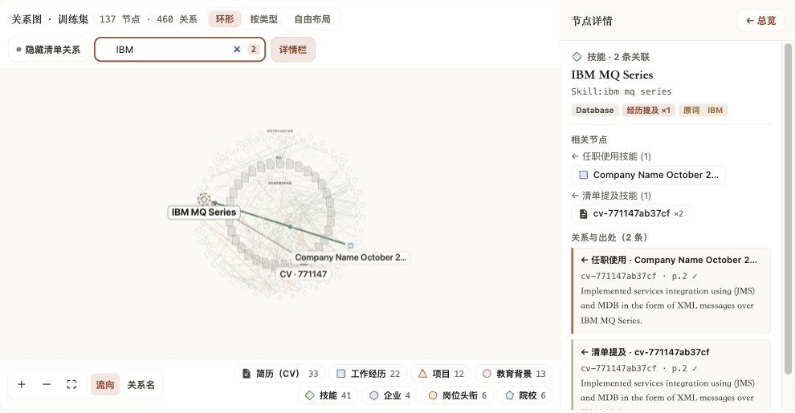

# 简历知识图谱与岗位匹配项目说明

智能信息系统建模　作业 2

丁宇轩 · 524031910745 · 独立完成全流程设计、开发、测试、录屏及文档撰写 · 贡献比例 100%。

## 项目概述

招聘人员拿到一份简历时，常常需要确认两件事：候选人是否提过某项技能，又是否在具体工作中用过它。本项目把技能、岗位、企业和经历连到简历原句。阅读者可以从岗位筛选结果回到候选人的项目，再打开 PDF 核对页码。

在 60 份训练简历上构建了 799 个可达领域节点和 2035 条有来源的关系。20 份独立测试简历仅参与应用评估。主岗位需求严格命中 9 人，极高门槛对照命中 0 人。

## 用户需求与实现

| 需求 | 实现结果 |
|---|---|
| 查看技能的使用场景 | 每条工作或项目技能关系都带原句；在单份简历关系图中可隐藏仅列在清单里的技能。 |
| 区分同名实体并归并别名 | 用记录上下文区分 IBM 公司和 IBM MQ Series；把 ML 与 Machine Learning 归入同一技能。 |
| 解释画像分数 | 四个能力维度各有四条规则。工作台给出命中项、训练阈值与来源记录。 |
| 按岗位条件比较简历 | 从独立测试集筛选，再比较前三人的四维画像、项目和实证技能；缺少硬条件的人单列。 |

## 业务操作流程

从「概览」的五步流程进入「采 · 原文」，选择一份简历，按页阅读或下载原始 PDF。进入「治 · 抽取」会沿用这份简历。选中一段经历，可核对关系图、高亮词和对应的原句。

在「存 · 图谱」中选择简历范围，搜索 IBM 或点选节点查看相邻关系和原句。「消歧」对照 IBM 的公司与技术产品含义，「归并」解释别名，「分布与审计」列出节点、关系和保留为不同实体的相似名称。

到「算 · 评分」选择维度，展开规则核对门槛与原文。「训练快照对比」展示样本增加后阈值如何变化，「重点简历画像」可下载个人报告。在「用 · 检索」输入需求，或点击示例填入后提交。阅读匹配概况、对比前三人，再从候选人详情跳回原文页核查。

## 五阶段技术建模

| 阶段 | 主要技术 | 形成的数据 |
|---|---|---|
| 采 · 原文 | PyMuPDF 逐页取文，文件与文本哈希去重，连续五词相似度复核 | 保留页码的原文、固定训练集与测试集 |
| 治 · 抽取 | 按记录切分上下文，用 GLiNER 标注实体，再按证据生成关系 | 工作、项目、教育记录及带引文的关系 |
| 存 · 图谱 | 上下文消歧、同类型别名归并、Neo4j 持久化 | 规范实体、双边消歧与防误并记录 |
| 算 · 评分 | 从训练样本标定特征阈值，逐人计算命中项 | 四维分数、训练快照和三份重点画像 |
| 用 · 检索 | 将中文条件转为 Cypher，测试集按硬条件过滤、按偏好排序 | 严格命中、近似候选、前三人比较和原件入口 |

## 实体消歧与共指消解

简历里的 IBM 有时是雇主，有时出现在技术产品名称中。系统用局部词窗相似度（50%）、段落位置（30%）和同条记录里的实体（20%）给两种含义评分。只有两种含义都有训练原句和独立关系，才算验证了一组。

| 来源页 | IBM 的原文 | 图谱关系 |
|---|---|---|
| cv-771147ab37cf · p.2 | Implemented services integration using (JMS) and MDB in the form of XML messages over IBM MQ Series. | USED_SKILL |
| cv-cb2be31d7dcd · p.2 | Name and address of employer IBM Global Services | AT_COMPANY |

训练集验证了 4 组同名消歧，涉及 Associate、IBM、MS、Oracle。共指消解则查找不同写法所指的同一实体。ML 与 Machine Learning 合为一项技能，C、C++ 和 C# 各自保留。训练集确认 11 组跨文档别名。全量记录还识别出 152 处文内指代，第一人称指向候选人，机构或项目泛指需匹配本条记录中的先行实体。

## 规则生成与重点画像

对教育背景、工作经历、技能水平和发展潜力分别取四个可核查的特征。训练集的经验分位数决定命中门槛。例如技能水平考查实证技能数、实证占比、技能总数和覆盖类别。每项达标得 25 分，每维最高 100 分。

将训练样本从 30 份扩大到 60 份后，5 条规则的阈值改变。固定的三位测试对象中，有 3 人的得分或等级随之变化。

| 重点简历 | 教育 | 经历 | 技能 | 潜力 |
|---|---|---|---|---|
| cv-016aac56a9c8 | 50 / C | 25 / B | 75 / A | 50 / A |
| cv-486c4ba1bcae | 100 / A | 25 / B | 100 / A | 50 / A |
| cv-ba27341202ab | 100 / A | 75 / A | 100 / A | 50 / A |

## 岗位检索与三人比较

主岗位需求为「本科及以上，掌握 Python、Java 或 SQL 任一项，有项目经验优先，熟悉 SQL 优先。」

测试集中有 9 人满足全部硬条件，另有 11 人列入近似候选。偏好条件用于排序。

| 严格命中前三人 | 净工龄（月） | 项目数 | 实证技能占比 |
|---|---|---|---|
| cv-486c4ba1bcae | 162 | 3 | 59.1% |
| cv-596fd946e861 | 21 | 1 | 50.0% |
| cv-01cd69a36273 | 348 | 0 | 100.0% |

前两人的简历均包含 SQL 和项目记录；第三人的净工龄较长，抽取到的技能均有实证，但没有独立项目记录。面试时可以从项目职责、用到的技术和任职日期三个角度分别追问。

对照需求为「博士学历，至少8年工作经验，同时掌握 Rust、Kubernetes 与 SAP。」严格命中 0 人，近似候选 20 人。近似列表逐人说明缺少的硬条件。

## 运行结果与材料

文中的得分描述简历所提供的证据，并受训练样本构成和日期可解析程度影响。持续至今的经历按快照月折算，较早撰写的简历可能高估工龄。

[旧版五阶段操作录像](../demo_video/五阶段演示.mp4) · [完整规则、引文与 Cypher](技术说明文档.md) · [运行方法](../README.md) · [逐项验收](../data/processed/acceptance_report.json)
